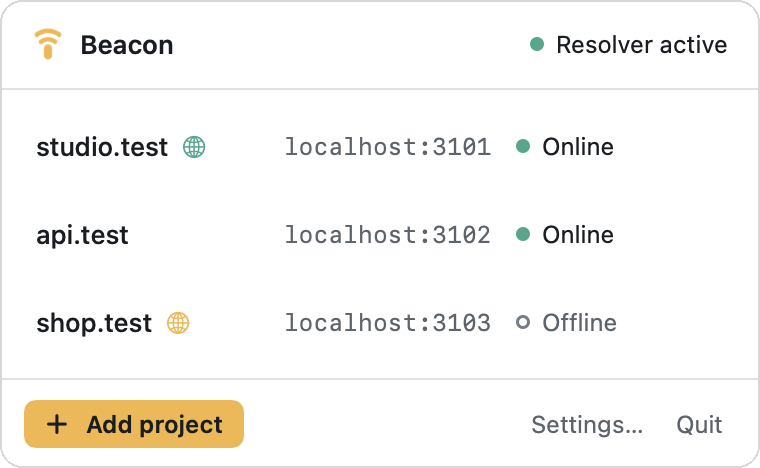
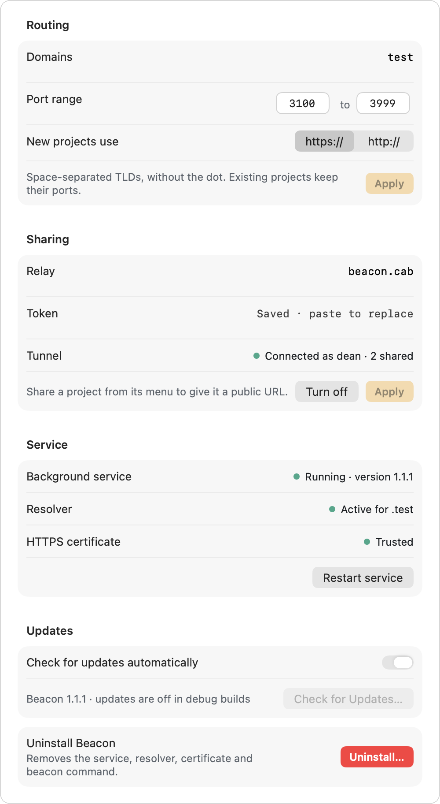

<p align="center">
  
</p>

<h3 align="center">DNS & reverse proxy for macOS</h3>

<p align="center">
  Beacon gives your local projects <code>.test</code> domains and routes requests to the right local port.
</p>

<p align="center">
  <a href="https://github.com/GlobusGroup/Beacon/releases/latest/download/Beacon.dmg"></a>
  <br>
  <sub>macOS 26 or later · signed and notarised · updates itself</sub>
</p>

<p align="center">
  <picture>
    <source media="(prefers-color-scheme: dark)" srcset="docs/images/menu-dark.png">
    
  </picture>
</p>

Ask Beacon for a port and it gives you one for good. `shop.test` then serves whatever listens on that port, over HTTP and HTTPS, with no port in the URL.

```
$ cd ~/projects/shop
$ beacon register

  shop  ● running
  URL        https://shop.test
  Plain      http://shop.test
  Port       3104  ← bind your dev server here
  Path       /Users/you/projects/shop
```

The port matters most. A project asks once and gets the same number every time after, so you can commit it to a `.env`, a `vite.config.js` or a setup script. Nobody has to remember which project had 3000 last week. Beacon never hands a reserved port to another project, even while the first one is stopped.

That also makes Beacon safe for coding agents. `beacon register --json` gives the same answer every time it runs, so an agent can call it at the start of each session, bind the dev server to the port it gets back, and hand you `https://shop.test` instead of `http://localhost:49213`.

## Install

Download [Beacon.dmg](https://github.com/GlobusGroup/Beacon/releases/latest/download/Beacon.dmg), open it and drag Beacon into Applications. The background service and the `beacon` command ship inside the app, so there's nothing else to install.

The first launch opens a setup window with two steps. Beacon explains each one before macOS shows its own dialog.

1. **Install the background service.** macOS asks for your password. Beacon registers its service with `launchd`, writes `/etc/resolver/test` and puts `beacon` in `/usr/local/bin`.
2. **Trust Beacon's certificate.** macOS asks you to approve a change to your certificate trust settings, with Touch ID or your password. After that, `https://` links to your projects work in Safari and Chrome.

Nothing asks for a password after that. Adding projects, changing settings and restarting the service all go through a socket the service opens for your user.

Beacon checks GitHub for new versions and installs them when you agree. When an update leaves the background service older than the app, the menu shows a card and Settings offers to update it. That takes your password once.

Uninstall from **Settings → Uninstall Beacon…**, or from a terminal:

```bash
beacon uninstall          # add --purge to also forget your projects
```

### Why the service asks for a typed password

The macOS dialog for installing a root service only has a password field. The certificate step accepts Touch ID because it changes your own keychain, not the system.

## Using it

```bash
beacon register                 # register the current directory
beacon register shop            # or give it a name
beacon register shop --domain shop.test --port 3000
beacon register shop --alias admin --alias api

beacon list                     # every project, and which are running
beacon info shop
beacon port shop                # just the number, for scripts
beacon url shop                 # just the URL
beacon open shop
beacon unregister shop

beacon restart                  # no sudo needed
beacon status                   # is the service healthy?
beacon config --add-tld dev     # serve another TLD as well as .test
beacon config --port-range 4000-4999
```

In a script:

```bash
PORT=$(beacon port) npm run dev
```

`--port`, or the Port field in the app's Add project window, asks for a specific port. Beacon refuses it in two cases. Either another project holds it (`port_taken`), or Beacon listens on it itself (`port_reserved_by_beacon`). The error names the owner and suggests a free port.

With `--json`, errors go to stdout as `{"ok": false, "error": {"code", "message", "suggestedPort", "hint", …}}` and the exit status is 1. `hint` is a command that will succeed.

### Start a project from the browser

Open a project's domain while its dev server is down and Beacon shows a page with a **Start** button. Click it to watch the command's output and a progress bar. The page reloads into your app once something answers on the port.

Beacon picks the command from what's in the project directory:

| Found | Runs |
| --- | --- |
| `compose.yaml` or `docker-compose.yml` that publishes the port | `docker compose up -d` |
| a compose file and a `package.json` | `docker compose up -d && npm run dev` |
| `package.json` with `dev`, `start` or `serve` | `npm run dev`, or `pnpm`, `yarn` or `bun` to match the lockfile. Vite, Astro and Nuxt get `--port $PORT` |
| `artisan` | `php artisan serve --port=$PORT` |
| `bin/dev` or `bin/rails` | `bin/dev`, or `bin/rails server -p $PORT` |
| `manage.py` | `python manage.py runserver 127.0.0.1:$PORT` |

For anything else, or to override the guess:

```bash
beacon register shop --run "make serve"   # 'auto' goes back to detecting
```

The command runs as the owner of the project directory in a login shell, so `nvm`, `asdf` and Docker are on the `PATH` as they are in your terminal. Beacon sets `PORT`, `BEACON_PORT` and `BEACON_URL`. The same controls from a terminal:

```bash
beacon start shop      # waits until it's up, printing its output
beacon logs shop       # follow the output afterwards
beacon stop shop       # also runs `docker compose stop` for compose projects
```

Only Beacon's own page can call the start endpoint. It requires a custom header, and Beacon refuses the CORS preflight another site would need to send it.

### Subdomains

`anything.shop.test` reaches `shop` without registering it. The DNS responder answers for every name under the domain and the certificate includes a wildcard. Use `--alias` when an unrelated domain should reach the same project.

### Tell your coding agent

```bash
beacon agent-guide --write
```

This adds a short section to `CLAUDE.md`, or `AGENTS.md` if that's what the project uses. It tells the agent to ask Beacon for the port and to give you the domain instead of a `localhost` URL.

## Share a project on a public URL

With a relay running on a server you control, any registered project can go on the internet in one command. [Run your own relay](#run-your-own-relay) sets one up.

```bash
beacon relay --url beacon.cab --token <token>   # once per Mac
beacon share shop                               # → https://shop-dean.beacon.cab
beacon share shop --password hunter2            # visitors need the password, any username
beacon unshare shop
beacon relay                                    # tunnel state and what's shared
```

<p align="center">
  <picture>
    <source media="(prefers-color-scheme: dark)" srcset="docs/images/settings-sharing-dark.png">
    
  </picture>
</p>

In the app, enter the relay and token under **Settings → Sharing**, then right-click a project and choose **Share on the internet…**. Shared projects get a globe icon, and the right-click menu copies or opens the public URL.

The Mac keeps one outbound WebSocket open to the relay while anything is shared. Nothing on the Mac listens on the internet, so there's no port forwarding or firewall change. The URL is `<project>-<label>.<domain>`, where the label comes from your token, so it's the same every time. Shares survive restarts until you unshare them.

Dev servers that check the `Host` header need to allow the relay's domain. For Vite, that's `server.allowedHosts: ['.beacon.cab']`. For Rails, `config.hosts << ".beacon.cab"`.

## Run your own relay

The relay, `beacon-relay`, is a small Linux server that runs in Docker behind Traefik. GitHub Actions builds it and publishes it to `ghcr.io/globusgroup/beacon-relay`. The server only needs two files, `docker-compose.yml` and `.env`, so this works on hosts where you get a control panel and no shell.

```
browser ──https──▶ Traefik ──http──▶ beacon-relay ══ WebSocket ══▶ beacond ──▶ 127.0.0.1:3104
                  (TLS, *.beacon.cab)    (routes by Host)        (on the Mac)
```

The steps use `beacon.cab` as the domain. Substitute yours.

### 1. Check what you need

- A Linux server with Docker and Traefik v3 already running, and the name of the Docker network Traefik watches.
- A domain whose DNS you manage in Cloudflare. Shares live one level below it, so give the relay a whole domain or a subdomain like `share.example.com`.
- A Cloudflare API token with **Zone → DNS → Edit** on that zone. Traefik uses it to get a wildcard certificate.

### 2. Point the domain at the server

In Cloudflare, add two records for the server's IP address. Set both to **DNS only**, the grey cloud, because Traefik terminates TLS itself.

| Type | Name | Content |
| --- | --- | --- |
| `A` | `beacon.cab` | server IP |
| `A` | `*` | server IP |

The wildcard means every name resolves. The relay decides which ones are live, so you never add records per share.

### 3. Give Traefik a wildcard certificate

Wildcard certificates need Let's Encrypt's DNS challenge. If your Traefik already has a Cloudflare resolver, note its name and skip to the timeout below. Otherwise add one to Traefik's static configuration:

```yaml
certificatesResolvers:
  cloudflare:
    acme:
      email: you@example.com
      storage: /letsencrypt/acme.json
      dnsChallenge:
        provider: cloudflare
```

Pass the Cloudflare token to Traefik's container as `CF_DNS_API_TOKEN`.

In the same configuration, set the read timeout on your HTTPS entrypoint to `0`. Traefik v3 closes connections after 60 seconds by default, which makes the tunnel reconnect every minute.

```yaml
entryPoints:
  websecure:
    transport:
      respondingTimeouts:
        readTimeout: 0
```

Restart Traefik.

### 4. Make a token for each person

Every Mac that shares projects needs a token. Make one per person:

```bash
openssl rand -hex 24
```

Each token gets a label, written `label:token`. The label goes into that person's URLs, so `dean` sharing `shop` gets `shop-dean.beacon.cab`. Labels are lowercase letters, digits and hyphens.

### 5. Add the compose file and environment

In your panel, create a stack from [`Relay/docker-compose.yml`](Relay/docker-compose.yml), unchanged. Then give it this `.env`, adjusted for your server:

```bash
IMAGE_TAG=main                   # or a release, such as 1.2.0
BEACON_DOMAIN=beacon.cab
BEACON_TOKENS=dean:3f9c…,sam:81aa…

TRAEFIK_NETWORK=traefik          # the Docker network Traefik watches
TRAEFIK_ENTRYPOINT=websecure     # your HTTPS entrypoint
TRAEFIK_CERTRESOLVER=cloudflare  # the resolver from step 3
```

The compose file publishes no ports. Traefik reaches the relay over its Docker network, and the compose labels ask it for a certificate covering `beacon.cab` and `*.beacon.cab`. [`Relay/.env.example`](Relay/.env.example) lists every setting with comments.

Deploy the stack. The relay keeps no state, so a redeploy costs a few seconds of reconnects and nothing else.

### 6. Check it's up

```bash
curl https://beacon.cab/healthz
```

You should get `{"ok":true}`. If not, the relay's log in your panel names the setting it rejected. The first certificate can take a minute to arrive.

### 7. Connect each Mac

Give each person their token. They enter the domain and token in **Settings → Sharing**, or run:

```bash
beacon relay --url beacon.cab --token <their token>
beacon share shop
```

Settings shows the tunnel as connected, and `https://shop-<label>.beacon.cab` serves the project.

### Day to day

- **Add someone.** Add their `label:token` to `BEACON_TOKENS` and redeploy.
- **Revoke someone.** Remove their entry and redeploy. Their tunnel can't reconnect.
- **Update the relay.** With `IMAGE_TAG=main`, pull and redeploy. Pin a release tag if you'd rather choose when to update.

[`Relay/README.md`](Relay/README.md) covers how the relay handles connections, every configuration variable, and running it locally.

## How it works

| Piece | What it does |
| --- | --- |
| `beacond` | Root `launchd` service. Owns everything below. |
| DNS responder | Listens on `127.0.0.1:53535`. `/etc/resolver/<tld>` points macOS at it. Answers every name under a managed TLD with `127.0.0.1`. |
| Reverse proxy | Binds `:80` and `:443`. Reads each request's `Host`, looks up the project and relays to `127.0.0.1:<port>`. |
| Certificate authority | A local root trusted in your login keychain, and one leaf certificate covering every registered domain. Beacon reissues it when the list changes. |
| Registry | `/Library/Application Support/Beacon/sites.json`, written on every change. |
| Control socket | `/var/run/beacon.sock`, group `staff`, so the CLI and the app work without `sudo`. |
| Tunnel client | One WebSocket to the relay while anything is shared. Settings and token live in `relay.json`, readable by root only. |

The proxy sets `X-Forwarded-Proto`, `-Host`, `-Port` and `-For` on every request, not only the first on a connection. Frameworks that build absolute URLs need that on each one. Before setting them, it drops any `X-Forwarded-*` headers the client sent. It never parses responses, so streaming, SSE and HTTP/1.0 pass through as they are. After a WebSocket upgrade or `CONNECT`, the connection becomes a plain byte relay.

### Why trusting the certificate is its own step

Trust goes in your login keychain, not the system one, and `beacon trust` runs as you, not root.

Writing system-wide trust needs an authorisation that macOS only grants when it can show a dialog to a logged-in person. A `launchd` daemon has no session to show one in, so the request fails with *"the authorization was denied since no user interaction was possible"*. `sudo security add-trusted-cert` fails the same way, because root doesn't have a session either. Per-user trust needs no privileges, asks once, and is what Safari and Chrome check.

In practice:

- Run `beacon trust` as yourself, at the Mac. Not with `sudo`, and not over SSH.
- `beacon status` reports trust for whoever runs it, because the answer differs per user. The daemon never reports it.
- Other user accounts on the same Mac run `beacon trust` once each.

## Developing

```bash
make dev
```

Runs the whole stack on ports 8080, 8443 and 15353 against a throwaway registry in `/tmp/beacon-dev`. It installs nothing. Drive it with `BEACON_ROOT=/tmp/beacon-dev .build/release/beacon …`.

To build from source instead of using the DMG:

```bash
make app        # builds Beacon.app; or open Beacon.xcodeproj and run it
make install    # installs the service and CLI from a terminal, no app
```

### Layout

```
Package.swift            daemon, CLI, shared library
Brand/                   brand kit v1.0: guide, logos, palette, concept board
Scripts/                 release, DMG and asset scripts, the app's embed build phase
Sources/beacond/         DNS, proxy, certificates, registry, control socket
Sources/beacon/          the CLI
Sources/BeaconTunnel/    tunnel wire format and HTTP head handling, shared with the relay
Sources/beacon-relay/    the public relay server (Linux)
Relay/                   Dockerfile, compose file and reference for the relay
Beacon/                  the menu bar app (Xcode target)
Beacon/Shared/           models and IPC, compiled into both the app and the package
Beacon.xcodeproj         the app
docs/images/             README artwork
```

`Beacon/Shared` is a SwiftPM target and also part of the app's synchronized file group. The app and the service share one definition of the wire format, and the Xcode project needs no package reference for it.

### Releasing

`Scripts/release.sh <version>` does the whole release. It sets the version, archives, exports a Developer ID-signed app, builds the DMG, notarises and staples it, then tags the commit and publishes a GitHub release. The release carries `Beacon.dmg` and a Sparkle `appcast.xml`, which installed copies read from `releases/latest/download/appcast.xml`.

`--dry-run` stops after the signed DMG, with nothing committed or pushed. The script needs `create-dmg` (`brew install create-dmg`), a notary profile and the Sparkle signing key in your keychain. Its header has the one-time setup.

## Brand


Warm, precise, native. Beacon pairs an amber signal with a plain macOS interface and keeps your projects in front. The kit in [`Brand/`](Brand) holds the [guide](Brand/Beacon-Brand-Guide.pdf), logos and palette.

| | Name | Hex | Use |
| --- | --- | --- | --- |
|  | Signal | `#F5B544` | Primary actions and selection |
|  | Ink | `#181C20` | Text and dark surfaces |
|  | Canvas | `#F5F3EE` | Light backgrounds |
|  | Slate | `#737C86` | Secondary icons and details |
|  | Online | `#38A88A` | Healthy route indicators |

Put Ink text on Signal buttons, and always pair a status colour with a label or icon. Write "Beacon" in prose and keep the logo's lowercase lettering. The concept board in `Brand/reference/` has an earlier tagline that's been dropped, so don't reuse it.

The app icon, menu bar icon, in-app artwork and DMG background all come from the kit. Rerun these after changing it:

```bash
swift Scripts/generate-brand-assets.swift
swift Scripts/render-dmg-background.swift
```
