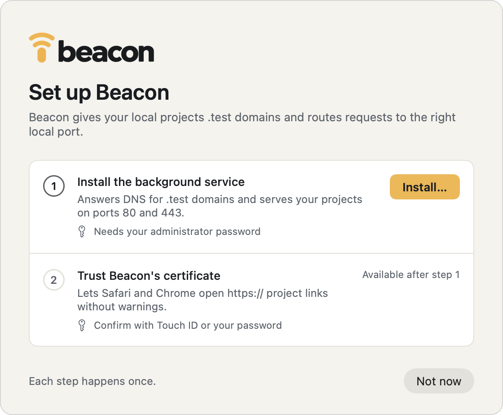
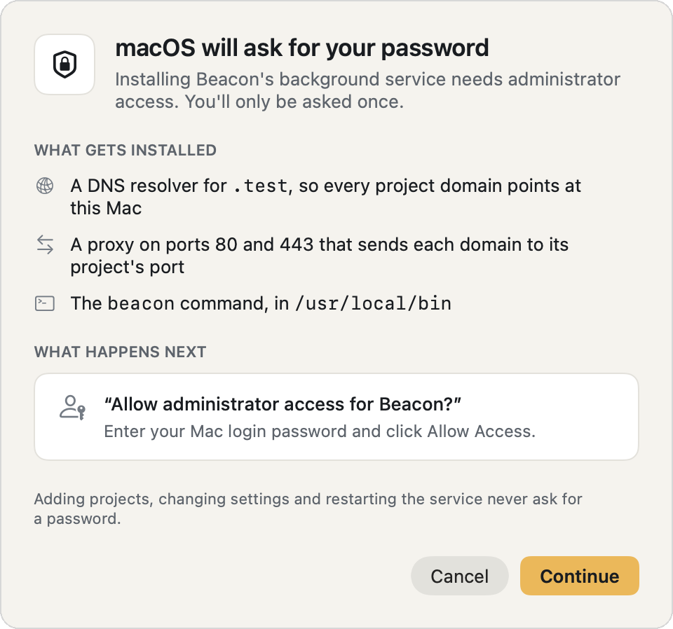
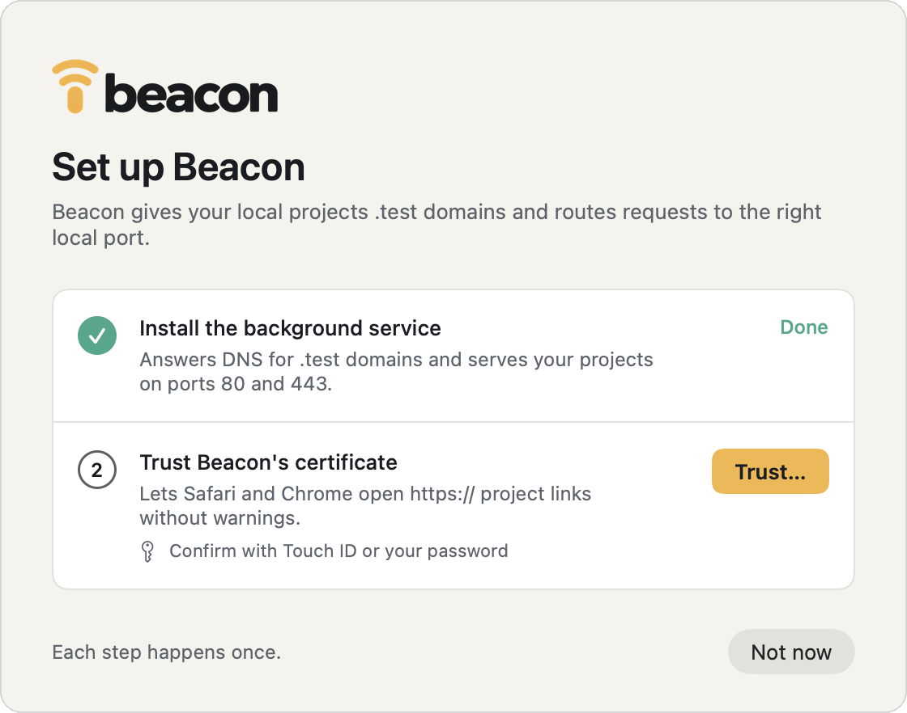
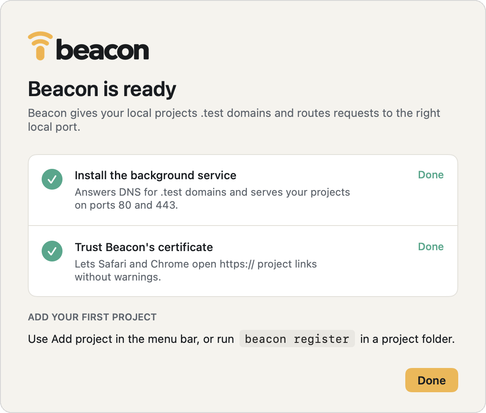

<p align="center">
  
</p>

<h3 align="center">DNS & reverse proxy for macOS</h3>

<p align="center">
  Beacon gives your local projects <code>.test</code> domains and routes requests to the right local port.
</p>

<p align="center">
  <a href="https://github.com/GlobusGroup/Beacon/releases/latest/download/Beacon.dmg"></a>
  <br>
  <sub>Requires macOS 26 or later</sub>
</p>

<p align="center">
  <picture>
    <source media="(prefers-color-scheme: dark)" srcset="docs/images/menu-dark.png">
    
  </picture>
</p>

When you register a project, Beacon picks a port for it and keeps that port reserved for the project from then on. Point your dev server at that port and you can open the project at `https://shop.test` instead of `localhost:3104`. Plain `http://` works too.

```
$ cd ~/projects/shop
$ beacon register

  shop  ● running
  URL        https://shop.test
  Plain      http://shop.test
  Port       3104  ← bind your dev server here
  Path       /Users/you/projects/shop
```

The fixed port is the part we use most. Because a project always gets the same number back, you can put it in a `.env`, a `vite.config.js` or a setup script and commit it. You don't end up with two projects fighting over port 3000, and Beacon won't give a project's port to anything else, even when that project isn't running.

It works well with coding agents for the same reason. Running `beacon register --json` again just returns the existing port, so an agent can call it at the start of every session, start the dev server on that port, and give you a `.test` link rather than a random `localhost` one.

## Install

Download [Beacon.dmg](https://github.com/GlobusGroup/Beacon/releases/latest/download/Beacon.dmg), open it and drag Beacon into Applications. The background service and the `beacon` command are bundled inside the app, so that's the only thing you need to download.

When you first open Beacon, a setup window walks you through two steps. Before each one, Beacon tells you what's about to change and which macOS dialog to expect, so you're not surprised by a password prompt.

<p align="center">
  <picture>
    <source media="(prefers-color-scheme: dark)" srcset="docs/images/setup-1-dark.png">
    
  </picture>
  <picture>
    <source media="(prefers-color-scheme: dark)" srcset="docs/images/setup-2-dark.png">
    
  </picture>
</p>

The first step installs the background service. Beacon lists what it's going to add, then macOS asks for your administrator password. The service gets registered with `launchd`, Beacon writes `/etc/resolver/test` so `.test` names resolve to your Mac, and the `beacon` command goes into `/usr/local/bin`.

<p align="center">
  <picture>
    <source media="(prefers-color-scheme: dark)" srcset="docs/images/setup-3-dark.png">
    
  </picture>
  <picture>
    <source media="(prefers-color-scheme: dark)" srcset="docs/images/setup-4-dark.png">
    
  </picture>
</p>

The second step trusts Beacon's certificate, so Safari and Chrome open `https://` project links without a warning. macOS asks you to confirm with Touch ID or your password.

That's the last password prompt you'll see in normal use. Adding projects, changing settings and restarting the service all go through a local socket that your user account can already talk to.

Beacon checks GitHub for new versions and asks before installing one. Sometimes an update also includes a newer background service. When that happens, the menu shows a card, and Settings has an Update button that asks for your password once.

To uninstall, use **Settings → Service → Uninstall…**, or run this in a terminal:

```bash
beacon uninstall          # add --purge to also forget your projects
```

If you're wondering why the first step wants a typed password rather than Touch ID, that's macOS. The dialog for installing a system service only offers a password field. The certificate step can use Touch ID because it only changes your own keychain.

## Using it

Most things are one command:

```bash
beacon register                 # register the current directory
beacon register shop            # or give it a name
beacon register shop --domain shop.test --port 3000
beacon register shop --alias admin --alias api

beacon list                     # every project, and which are running
beacon info shop
beacon port shop                # just the number, for scripts
beacon url shop                 # just the URL
beacon open shop
beacon unregister shop

beacon restart                  # no sudo needed
beacon status                   # is the service healthy?
beacon config --add-tld dev     # serve another TLD as well as .test
beacon config --port-range 4000-4999
```

`beacon port` is handy in scripts:

```bash
PORT=$(beacon port) npm run dev
```

If you want a particular port, pass `--port` or fill in the Port field in the app's Add project window. Beacon will say no if another project already has it (`port_taken`) or if Beacon uses it itself (`port_reserved_by_beacon`). Either way, the error tells you who owns it and suggests a free one.

Add `--json` to get machine-readable output. Errors then go to stdout as `{"ok": false, "error": {"code", "message", "suggestedPort", "hint", …}}` with exit status 1, and `hint` is a command that will work.

### Starting a project from the browser

If you open a project's domain while its dev server isn't running, Beacon shows a page with a **Start** button. Click it and you'll see the command's output and a progress bar, and the page switches over to your app once it's answering on the port.

Beacon works out which command to run from the files in the project directory:

| Found | Runs |
| --- | --- |
| `compose.yaml` or `docker-compose.yml` that publishes the port | `docker compose up -d` |
| a compose file and a `package.json` | `docker compose up -d && npm run dev` |
| `package.json` with `dev`, `start` or `serve` | `npm run dev`, or `pnpm`, `yarn` or `bun` to match the lockfile. Vite, Astro and Nuxt get `--port $PORT` |
| `artisan` | `php artisan serve --port=$PORT` |
| `bin/dev` or `bin/rails` | `bin/dev`, or `bin/rails server -p $PORT` |
| `manage.py` | `python manage.py runserver 127.0.0.1:$PORT` |

If your project isn't covered, or Beacon guesses wrong, set the command yourself:

```bash
beacon register shop --run "make serve"   # 'auto' goes back to detecting
```

The command runs as whoever owns the project directory, in a login shell, so tools like `nvm`, `asdf` and Docker are on the `PATH` just like in your terminal. Beacon also sets `PORT`, `BEACON_PORT` and `BEACON_URL` for it.

You can do the same from a terminal:

```bash
beacon start shop      # waits until it's up, printing its output
beacon logs shop       # follow the output afterwards
beacon stop shop       # also runs `docker compose stop` for compose projects
```

Other websites can't start your projects. The start request needs a custom header, and Beacon turns down the CORS check a browser would make before sending it from another site.

### Subdomains

Anything under a project's domain goes to that project, so `admin.shop.test` reaches `shop` without registering it. Beacon's DNS answers for every name under the domain, and the certificate has a wildcard to match. You only need `--alias` when a completely different domain should point at the same project.

### Calling a project from Docker containers

Inside a container, `shop.test` resolves to the container itself, and the container doesn't trust Beacon's certificate. For a Docker Compose project, run this in the project directory:

```bash
beacon docker init
```

It writes `compose.override.yaml`, which Compose loads on its own. The override adds a small `beacon` sidecar that answers for the project's domains on the compose network and forwards to Beacon on your Mac, plus a CA bundle every service trusts. After `docker compose up`, the services can call `https://shop.test` without `-k`. There's no change to Docker's settings, and it works on Docker Desktop, OrbStack and Colima.

Subdomains the containers call have to be listed with `--domain api.shop.test`, because Docker's network aliases can't be wildcards. [Sidecar/README.md](Sidecar/README.md) has the rest.

### Telling your coding agent

Once Beacon is set up, the menu offers to add a short note to Claude Code and Codex. It tells them to get the port from Beacon rather than picking one, and to give you the `.test` URL instead of a `localhost` one. If you close the prompt, you can still add it later under **Settings → Coding agents**.

The same thing from a terminal, for every project:

```bash
beacon agent-guide --global   # ~/.claude/CLAUDE.md and ~/.codex/AGENTS.md
```

Or just for one project, in its `CLAUDE.md`, or `AGENTS.md` if that's the one you use:

```bash
beacon agent-guide --write
```

## Sharing a project on a public URL

If you have a relay running (there's a setup guide [further down](#running-your-own-relay)), you can put any registered project on the internet, which is useful for showing someone work in progress or testing webhooks.

```bash
beacon relay --url relay.example.com --token <token>   # once per Mac
beacon share shop                    # → https://shop-dean.relay.example.com
beacon share shop --password hunter2 # visitors need the password, any username
beacon unshare shop
beacon relay                         # tunnel state and what's shared
```

<p align="center">
  <picture>
    <source media="(prefers-color-scheme: dark)" srcset="docs/images/settings-sharing-dark.png">
    
  </picture>
</p>

In the app, put the relay address and your token in **Settings → Sharing**. Then right-click a project and choose **Share on the internet…**. Shared projects get a little globe next to them, and the right-click menu has options to copy or open the public link.

While something is shared, your Mac keeps a connection open to the relay and visitors' requests come back down it. Nothing on your Mac is listening on the internet, so you don't need to touch your router or firewall. The address is always `<project>-<label>.<domain>`, where the label comes from your token, so the link stays the same each time you share. Shares also stay on through restarts until you turn them off.

Some dev servers only answer requests for hostnames they know about, so you may need to allow the relay's domain. In Vite that's `server.allowedHosts: ['.relay.example.com']`, and in Rails it's `config.hosts << ".relay.example.com"`.

## Running your own relay

The relay is a small server called `beacon-relay`. It runs in Docker behind Traefik, and GitHub Actions publishes the image to `ghcr.io/globusgroup/beacon-relay`. All the server needs is a compose file and a `.env`, so you can set it up from a hosting control panel without shell access.

```
browser ──https──▶ Traefik ──http──▶ beacon-relay ══ WebSocket ══▶ beacond ──▶ 127.0.0.1:3104
                   terminates TLS    routes by Host                on the Mac
```

These steps use `relay.example.com` as the relay's domain. Swap in your own wherever you see it.

### 1. Check you have what you need

- A Linux server running Docker and Traefik v3. You'll need the name of the Docker network Traefik watches.
- A domain with its DNS in Cloudflare. Shared projects get addresses one level below it, so use a domain or subdomain that's just for the relay.
- A Cloudflare API token with **Zone → DNS → Edit** permission on that domain. Traefik uses it to get a wildcard certificate.

### 2. Point the domain at your server

In Cloudflare, add these two records with your server's IP address. Set both to **DNS only** (the grey cloud), because Traefik handles TLS itself.

| Type | Name | Content |
| --- | --- | --- |
| `A` | `relay.example.com` | server IP |
| `A` | `*.relay.example.com` | server IP |

The wildcard record means every name under the domain reaches your server. The relay works out which ones are actually shared, so you never have to add DNS records for individual projects.

### 3. Set up a wildcard certificate in Traefik

Wildcard certificates have to come through Let's Encrypt's DNS challenge. If your Traefik already has a Cloudflare resolver set up, make a note of its name and skip ahead to the timeout setting below. If not, add one to Traefik's static configuration:

```yaml
certificatesResolvers:
  cloudflare:
    acme:
      email: you@example.com
      storage: /letsencrypt/acme.json
      dnsChallenge:
        provider: cloudflare
```

Then give Traefik's container your Cloudflare token as the `CF_DNS_API_TOKEN` environment variable.

While you're in Traefik's static configuration, set the read timeout on your HTTPS entrypoint to `0`. By default Traefik v3 drops connections after 60 seconds, which would make the tunnel reconnect every minute.

```yaml
entryPoints:
  websecure:
    transport:
      respondingTimeouts:
        readTimeout: 0
```

Restart Traefik once you've made these changes.

### 4. Make a token for each person

Everyone who'll be sharing projects needs their own token. You can generate one with:

```bash
openssl rand -hex 24
```

Each token is paired with a label, written as `label:token`. The label ends up in that person's links, so if `dean` shares `shop`, it's at `shop-dean.relay.example.com`. Labels can use lowercase letters, numbers and hyphens.

You only need to do this for yourself. List your label in `BEACON_ADMINS` and your token becomes an admin token, which lets you add everyone else from the Beacon app (see [Looking after it](#looking-after-it)).

### 5. Add the compose file and environment

In your control panel, create a new stack using [`Relay/docker-compose.yml`](Relay/docker-compose.yml) as it is. Then give it a `.env` like this one, changed to match your setup:

```bash
IMAGE_TAG=main                   # or a release, such as 1.2.0
BEACON_DOMAIN=relay.example.com
BEACON_TOKENS=dean:3f9c…
BEACON_ADMINS=dean

TRAEFIK_NETWORK=traefik          # the Docker network Traefik watches
TRAEFIK_ENTRYPOINT=websecure     # your HTTPS entrypoint
TRAEFIK_CERTRESOLVER=cloudflare  # the resolver from step 3
```

You don't need to open any ports for the relay. Traefik talks to it over the Docker network, and the labels in the compose file ask Traefik for a certificate covering `relay.example.com` and `*.relay.example.com`. If you want to see every available setting, [`Relay/.env.example`](Relay/.env.example) has them all with comments.

Now deploy the stack. The only thing the relay stores is the tokens admins create, in the `relay-data` volume, so you can redeploy it whenever you like. Anyone sharing will just reconnect a few seconds later.

### 6. Check it's running

```bash
curl https://relay.example.com/healthz
```

You should get back `{"ok":true}`. If you don't, check the relay's logs in your panel, which will tell you which setting it didn't like. Bear in mind the certificate can take a minute or so to come through the first time.

### 7. Connect each Mac

Send each person a `.beacon` file (see below), or their token. Opening the file in Beacon fills in **Settings → Sharing**; they press **Apply**. With a plain token, they can enter the relay address and token there themselves, or run:

```bash
beacon relay --url relay.example.com --token <their token>
beacon share shop
```

Once Settings shows the tunnel as connected, the project should be live at `https://shop-<label>.relay.example.com`.

### Looking after it

With an admin token, **Settings → Relay access** lists everyone who can use the relay, whether they're connected and what they're sharing. **New token…** makes a token for someone and saves it as a `.beacon` file holding the relay address and the token: send them that file. The token isn't shown again, so save the file before leaving that screen. **Revoke** takes a token away and closes that person's tunnel at once. From a terminal, `beacon relay invite sam --note "Sam's laptop"`, `beacon relay tokens` and `beacon relay revoke sam` do the same.

Tokens made this way are kept on the relay, in its `relay-data` volume. Tokens in `BEACON_TOKENS` show up in the list too, but can only be added or removed by editing `BEACON_TOKENS` and redeploying.

If `IMAGE_TAG` is `main`, pulling and redeploying gets you the latest relay. If you'd rather decide when to update, set it to a release number instead.

There's more detail on how the relay handles connections, the full list of settings, and how to run it locally in [`Relay/README.md`](Relay/README.md).

## How it works

Behind the app there's a single background service, `beacond`, that runs as root under `launchd` and handles everything else in this table:

| Piece | What it does |
| --- | --- |
| DNS responder | Listens on `127.0.0.1:53535`. `/etc/resolver/<tld>` points macOS at it, and it answers every name under a managed TLD with `127.0.0.1`. |
| Reverse proxy | Listens on ports 80 and 443. It reads the `Host` of each request, finds the project and passes the request on to `127.0.0.1:<port>`. It also serves the root certificate's public half at `/__beacon/ca.pem` on any host, for the Docker sidecar. |
| Certificate authority | A local root certificate that your login keychain trusts, plus one certificate covering every registered domain. Beacon reissues that certificate whenever the list of domains changes. |
| Registry | `/Library/Application Support/Beacon/sites.json`, saved on every change. |
| Control socket | `/var/run/beacon.sock`, owned by the `staff` group, which is why the CLI and the app work without `sudo`. |
| Tunnel client | Keeps a WebSocket open to the relay while anything is shared. The relay settings and token are in `relay.json`, which only root can read. |

The proxy sets `X-Forwarded-Proto`, `-Host`, `-Port` and `-For` on every request, not just the first one on a connection, because frameworks that build absolute URLs need them every time. It also throws away any `X-Forwarded-*` headers the browser sent, so they can't be spoofed. Responses go back untouched, which means streaming, server-sent events and HTTP/1.0 all work. After a WebSocket upgrade or a `CONNECT`, the proxy just copies bytes in both directions.

### Why trusting the certificate is a separate step

Beacon adds its certificate to your login keychain rather than the system one, and `beacon trust` runs as you rather than as root.

That's because macOS will only let a program change system-wide certificate trust if it can show a dialog to someone sitting at the Mac. The background service doesn't have a screen to show one on, so macOS refuses with *"the authorization was denied since no user interaction was possible"*. Running `sudo security add-trusted-cert` fails the same way, since being root doesn't give you a screen either. Trust in your own keychain doesn't need admin rights, only asks once, and it's what Safari and Chrome look at anyway.

A few things follow from that:

- Run `beacon trust` as yourself while you're at the Mac, not with `sudo` and not over SSH.
- `beacon status` shows whether the certificate is trusted for whoever runs it, since it can differ between users. The background service never reports it.
- If there's more than one user account on the Mac, each person runs `beacon trust` once for themselves.

## Developing

```bash
make dev
```

This runs everything on ports 8080, 8443 and 15353 against a throwaway registry in `/tmp/beacon-dev`, without installing anything. You can talk to it with `BEACON_ROOT=/tmp/beacon-dev .build/release/beacon …`.

To build from source instead of using the DMG:

```bash
make app        # builds Beacon.app; or open Beacon.xcodeproj and run it
make install    # installs the service and CLI from a terminal, no app
```

The app icon, menu bar icon, in-app artwork and DMG background are all generated from the brand kit in `Brand/`. If you change the kit, rerun:

```bash
swift Scripts/generate-brand-assets.swift
swift Scripts/render-dmg-background.swift
```

### Layout

```
Package.swift            daemon, CLI, shared library
Brand/                   brand kit: guide, logos, palette
Scripts/                 release, DMG and asset scripts, the app's embed build phase
Sources/beacond/         DNS, proxy, certificates, registry, control socket
Sources/beacon/          the CLI
Sources/BeaconTunnel/    tunnel wire format and HTTP head handling, shared with the relay
Sources/beacon-relay/    the public relay server (Linux)
Relay/                   Dockerfile, compose file and reference for the relay
Sidecar/                 the container image `beacon docker init` adds to compose projects
Beacon/                  the menu bar app (Xcode target)
Beacon/Shared/           models and IPC, compiled into both the app and the package
Beacon.xcodeproj         the app
docs/images/             README artwork
```

`Beacon/Shared` is both a SwiftPM target and part of the app's synchronized file group. That way the app and the service share one definition of the messages they send each other, and the Xcode project doesn't need a package reference for it.

### Releasing

`Scripts/release.sh <version>` handles a whole release. It bumps the version, builds and signs the app with the team's Developer ID, makes the DMG and gets it notarised. Then it tags the commit and publishes a GitHub release with `Beacon.dmg` and a Sparkle `appcast.xml`. Installed copies check that appcast to find updates.

Add `--dry-run` to stop once the signed DMG is built, without committing or pushing anything. You'll need `create-dmg` (`brew install create-dmg`), a notary profile and the Sparkle signing key in your keychain. The comments at the top of the script cover the one-time setup.
